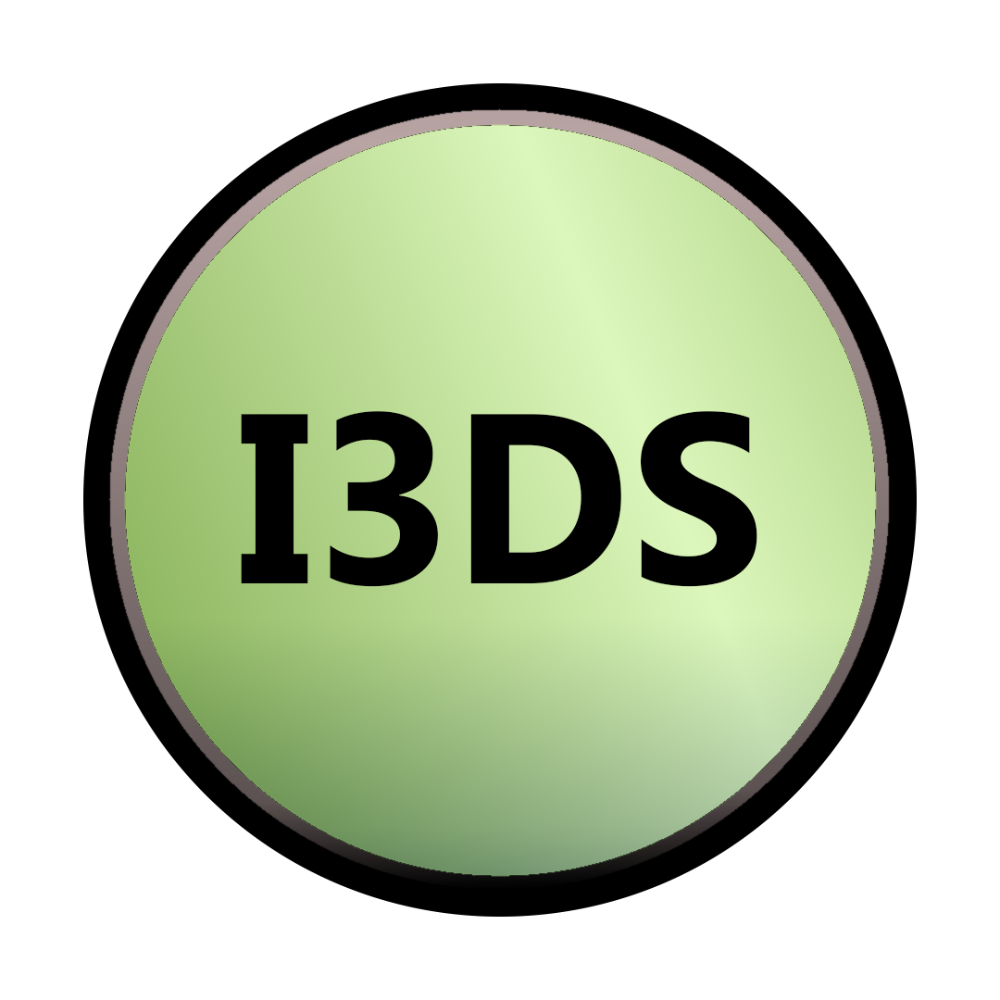

# Iron3D Studio

DCC 3D open source (Static Forge) que replica el flujo de trabajo de Cinema 4D R19 —
código 100% propio, reimplementación clean-room — con evaluación en GPU (Vulkan),
compatibilidad con `.c4d`/`.lib4d` y plugins de R19.

**Antes de tocar nada:** lee `AGENTS.md` (reglas clean-room, no negociables) y el
Documento Maestro del proyecto en `V:\ObsidianVault\14-Iron3D-CoalMix\Iron3D_CoalMix_Documento_Maestro_2026-10-27.pdf`
(resumen en `estado.md` de esa misma carpeta).

Estado (2026-10-28): Fase 1 y Fase 2 (grafo de escena + Gestor de Objetos + gizmo de
transformación mover/rotar/escalar, sin importación Cineware) completadas y verificadas
en vivo — ventana Vulkan + ImGui, cubo de prueba, cámara orbital estilo C4D. Ver
`AGENTS.md` §5 para el stack y `estado.md` del vault para el detalle de cada fase.

## Estructura

```
src/
  core/            ECS, Data-Oriented Design, grafo de escena (TRS)
  gfx/              VulkanDevice, VMA, VulkanPipeline, VulkanCompute, VulkanRayTracing
  iron_compute/     Clonadores e instancing masivo en compute shaders
  ui/               Paneles ImGui
  sdk/              Iron3D SDK (API C++ de plugins)
  python/           CPython embebido + módulo `iron` (pybind11)
  importers/
    cineware/       Lector/escritor .c4d (Cineware SDK de Maxon, antes "Melange" --
                    renombrado 2019; módulo opcional, revisar licencia)
    lib4d/          Parser de .lib4d -> .ilib
    c4d_compat/     Módulo `c4d` + ABI .cdl64 (fase tardía)
tools/
  dump_c4d_api.py   Ejecutar DENTRO de R19 (Script Manager) — Python 2.7
iron3d-py2compat/   Paquete Python 3 para cargar plugins .pyp de R19 (hecho, 23 tests
                    originales pendientes de localizar — ver su README.md)
shaders/            GLSL -> SPIR-V
tests/oracle/       Casos comparados contra C4D R19 (caja negra)
docs/api/           c4d_r19_api.json (salida de dump_c4d_api.py)
assets/             Presets .ilib, iconos y temas propios
```

## Licencia

Dual MIT OR Apache-2.0, a tu elección -- ver [`LICENSE-MIT`](LICENSE-MIT) y
[`LICENSE-APACHE`](LICENSE-APACHE).
