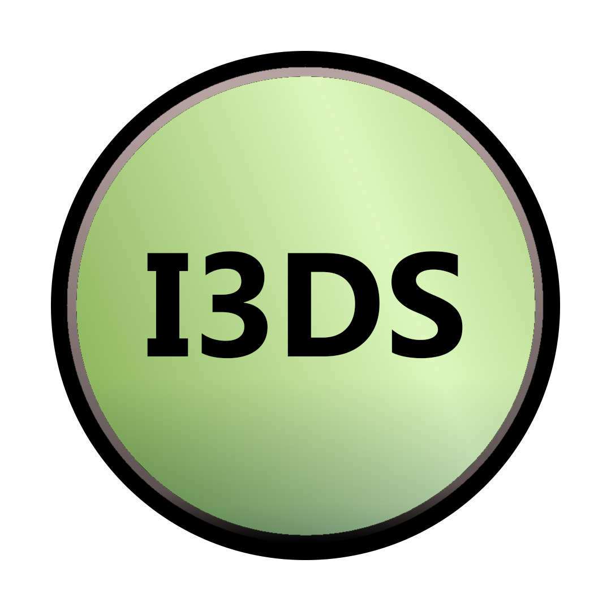
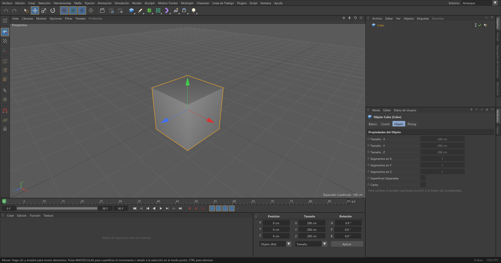
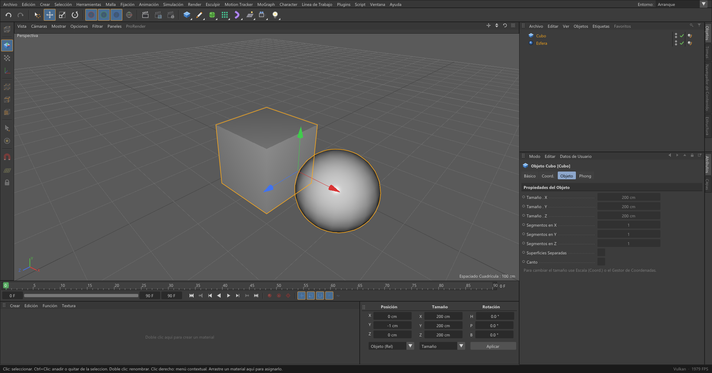

# Iron3D Studio

**Página del proyecto:** [staticforge.me/i3ds.html](https://staticforge.me/i3ds.html)

## Capturas



*El espacio de trabajo: menús, barras de herramientas, visor 3D, Gestor de Objetos, Atributos, Línea de Tiempo y Gestor de Coordenadas. Todos los iconos están dibujados en código.*



*Selección múltiple (Mayús+clic en el visor, Ctrl+clic en el Gestor de Objetos): contorno naranja en todo lo seleccionado y el eje de transformación en el centro del conjunto.*

DCC 3D open source (Static Forge) que replica el flujo de trabajo de Cinema 4D R19 —
código 100% propio, reimplementación clean-room — con evaluación en GPU (Vulkan),
compatibilidad con `.c4d`/`.lib4d` y plugins de R19.

**Antes de tocar nada:** lee `AGENTS.md` (reglas clean-room, no negociables) y el
Documento Maestro del proyecto en `V:\ObsidianVault\14-Iron3D-CoalMix\Iron3D_CoalMix_Documento_Maestro_2026-10-27.pdf`
(resumen en `estado.md` de esa misma carpeta).

Estado (2026-11-04): en desarrollo temprano, sin versión publicada. Fases 1 y 2 hechas
(grafo de escena, Gestor de Objetos, gizmo mover/rotar/escalar). Desde entonces: render
PBR con sombras y SSAO (Vulkan), selección múltiple, modos libres del gizmo, 222 iconos
propios, presets de interfaz (Cinema 4D, Blender, Maya, 3ds Max, Source Filmmaker) e
importación de `.c4d` (Windows; mallas, primitivas, jerarquía y materiales).
Qué se probó y qué no, en [`CHANGELOG.md`](CHANGELOG.md); las notas largas, en
[`docs/devlog/`](docs/devlog/). Ver `AGENTS.md` §5 para el stack.

## Compilar

```
cmake -S . -B build
cmake --build build --config Debug
ctest --test-dir build -C Debug
```

Para abrir `.c4d` hace falta el Cineware SDK de Maxon (gratuito, no viene en el repo; ver
su licencia en `AGENTS.md` §7). En Windows, añade `-DIRON3D_CINEWARE_SDK=<carpeta del SDK>`
al primer comando. Sin el SDK, Iron3D compila igual y avisa de que no puede abrir `.c4d`.

## Estructura

```
src/
  core/            ECS, Data-Oriented Design, grafo de escena (TRS)
  gfx/              VulkanDevice, VMA, VulkanPipeline, VulkanCompute, VulkanRayTracing
  iron_compute/     Clonadores e instancing masivo en compute shaders
  ui/               Paneles ImGui
  sdk/              Iron3D SDK (API C++ de plugins)
  python/           CPython embebido + módulo `iron` (pybind11)
  importers/
    cineware/       Importador .c4d (Cineware SDK de Maxon, antes "Melange"; opcional,
                    solo Windows; sin el SDK se compila un stub)
    lib4d/          Lector y escritor propios de librerías .lib4d (Navegador de Contenido)
    c4d_compat/     Geometría y coordenadas de C4D sin el SDK (primitivas, TRS); más
                    adelante, el módulo `c4d` + ABI .cdl64
tools/
  c4d_probe.cpp     Importa un .c4d sin ventana y lista lo que sale (necesita el SDK)
  dump_c4d_api.py   Ejecutar DENTRO de R19 (Script Manager) — Python 2.7
iron3d-py2compat/   Paquete Python 3 para cargar plugins .pyp de R19 (hecho, 23 tests
                    originales pendientes de localizar — ver su README.md)
shaders/            GLSL -> SPIR-V
tests/oracle/       Casos comparados contra C4D R19 (caja negra)
docs/api/           c4d_r19_api.json (salida de dump_c4d_api.py)
assets/             Presets .ilib, iconos y temas propios
```

## Licencia

Dual MIT OR Apache-2.0, a tu elección -- ver [`LICENSE-MIT`](LICENSE-MIT) y
[`LICENSE-APACHE`](LICENSE-APACHE).
